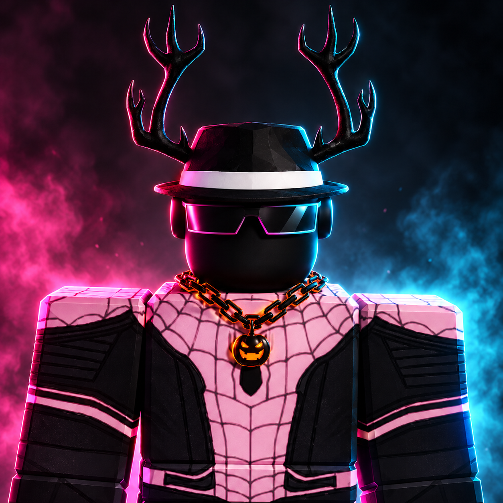

# Hey there, I'm Samuel 👋
### Founder & Developer at **RoarDevStudios** 🚀

  <em>Crafting thoughtful desktop software, expressive web experiences, and interactive worlds in purple & electric blue.</em>

  
  
  
  

---

## 💡 About Me

- 🔭 **Building**: [**Hive**](https://hivetools.pro) — an all-in-one desktop productivity workspace for Windows & Linux with an online companion portal at **hivetools.pro**.
- 🌐 **Web Development**: High-performance digital products, interactive portfolios, and web apps with modern web standards.
- 🎮 **Game Systems**: Modular gameplay mechanics, interactive logic, and virtual environments in Roblox Studio.
- ⚡ **Philosophy**: *Ideas into things that feel alive. Curious by default, shipping one polished detail at a time.*

---

## 🚀 Featured Projects

<table>
  <tr>
    <td width="50%" valign="top">
      <h3 align="center">🖥️ Hive Desktop & Platform</h3>
      

        A connected desktop workspace with cross-platform installers (Windows & Linux) paired with developer tools at <b>hivetools.pro</b>.
      

      

        <a href="https://hivetools.pro"><b>Launch hivetools.pro →</b></a>
      

    </td>
    <td width="50%" valign="top">
      <h3 align="center">🌐 RoarDevStudios Portfolio</h3>
      

        A bespoke portfolio in purple & blue cyber aesthetics featuring Aceternity 3D Cubes Grid and Dotted Glow background effects.
      

      

        <a href="https://roardevstudios-portfolio.vercel.app/"><b>Visit Live Site →</b></a>
      

    </td>
  </tr>
  <tr>
    <td width="50%" valign="top">
      <h3 align="center">🎮 Interactive Game Worlds</h3>
      

        Roblox Studio experiences focused on responsive physics, intuitive controls, inventory and economy mechanics, and rewarding multiplayer loops.
      

      

        <a href="https://github.com/roardevstudios?tab=repositories"><b>Explore Repositories →</b></a>
      

    </td>
    <td width="50%" valign="top">
      <h3 align="center">🛠️ Hive Tools Web Platform</h3>
      

        Web-based suite providing documentation, API keys, and companion features for the Hive ecosystem.
      

      

        <a href="https://hivetools.pro"><b>Explore Hive Tools →</b></a>
      

    </td>
  </tr>
</table>

---

## 🧰 Tech Stack & Tools

| Domain | Technologies |
| :--- | :--- |
| **Languages** |      |
| **Frameworks & Libraries** |     |
| **Cloud & Backend** |    |
| **Tools & Platforms** |     |

---

## 📈 GitHub Activity & Stats

  

---

## 🛠️ Recently Featured Repositories

| Repository | Description | Tech |
| :--- | :--- | :--- |
| **[portfolio_repo](portfolio_repo/)** | Personal portfolio site — purple & blue cyber aesthetics with Aceternity 3D Cubes Grid and Dotted Glow effects. | HTML · CSS · JS · Vercel |
| **[hivetools.pro](https://hivetools.pro)** | Hive companion web platform — documentation, API keys, and companion features for the Hive ecosystem. | Astro · Vercel |
| **Hive Desktop** | Cross-platform desktop productivity workspace for Windows & Linux. | Electron · React · TypeScript |

  
<b>👀 View all public repositories</b>

Explore the full catalog of public work on GitHub.

---

## 🤝 Let's Connect

- 🌐 **Portfolio**: [roardevstudios-portfolio.vercel.app](https://roardevstudios-portfolio.vercel.app/)
- ⚡ **Hive**: [hivetools.pro](https://hivetools.pro)
- 💬 **Discord**: Direct message me via [Discord User Profile](https://discord.com/users/1452045014984032448)
- 🐙 **GitHub**: [@roardevstudios](https://github.com/roardevstudios)
- 💼 **Available for**: Freelance projects, collaborations, and engineering experiments.

  © RoarDevStudios · Built with care & curiosity

